# 校园直播实训平台操作手册

## 1. 开始使用：账号与登录

平台只有两种角色：**管理员**（即教师，负责开课、商品、账号和积分管理）和**员工**（观看直播、积分兑换）。平台不开放自行注册，账号均由管理员统一创建。

| 角色 | 访问入口 | 主要任务 |
| --- | --- | --- |
| 管理员 | https://live.gaiademo.online/admin | 备课、开播、发放积分、处理订单 |
| 员工 | https://live.gaiademo.online/ | 观看直播、聊天、领券、积分兑换、看回放 |

两个入口使用同一域名下的登录会话。电脑上同时使用两种身份时，请用不同浏览器或无痕窗口，避免互相顶替。

**登录与首次改密（所有人员）**

1. 从管理员处获取账号和初始密码，账号可以是工号、学号等，不必是邮箱。
2. 打开对应入口，输入账号、密码，点击「进入工作台」或「进入课堂」。
3. 首次登录或密码被重置后，必须先修改密码：输入当前密码、新密码、再次确认。
4. **新密码至少 12 位，不能与原密码相同**。保存后用新密码重新登录。

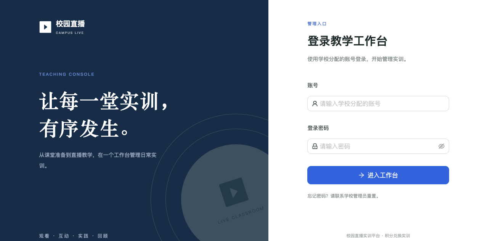


忘记密码：联系管理员重置。提示「此入口仅供……使用」：先退出当前账号，再进入对应身份的入口。新建账号的默认初始密码是 `123456`，请以管理员实际通知为准，不要长期使用。

## 2. 管理员：课前准备

### 2.1 查看教学概览

登录管理端后，可查看待开播、直播中、待交付订单和有回放的课堂；左侧栏是各业务模块入口。

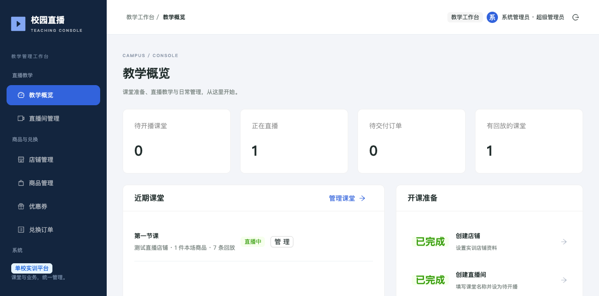

### 2.2 创建店铺和直播间

1. 进入「店铺管理」，点击「新建店铺」，填写店铺名称，简介可选，保存。
2. 进入「直播间管理」，点击「新建直播间」，选择所属店铺、填写课堂标题，保存。
3. 在列表点击「配置本场」→「编辑课堂」，将准备好的课堂设为「待开播」。

| 状态 | 含义与处理 |
| --- | --- |
| 准备中 | 草稿，员工不可见；用于备课 |
| 待开播 | 课堂已开放，尚未收到 OBS 推流 |
| 直播中 | OBS 成功推流后自动更新，无需手动设置 |
| 已结束 | 停止推流后自动更新；有录制时可查看回放 |

修改页面状态不会启动或停止直播，真正开播、停播必须在 OBS 中操作。

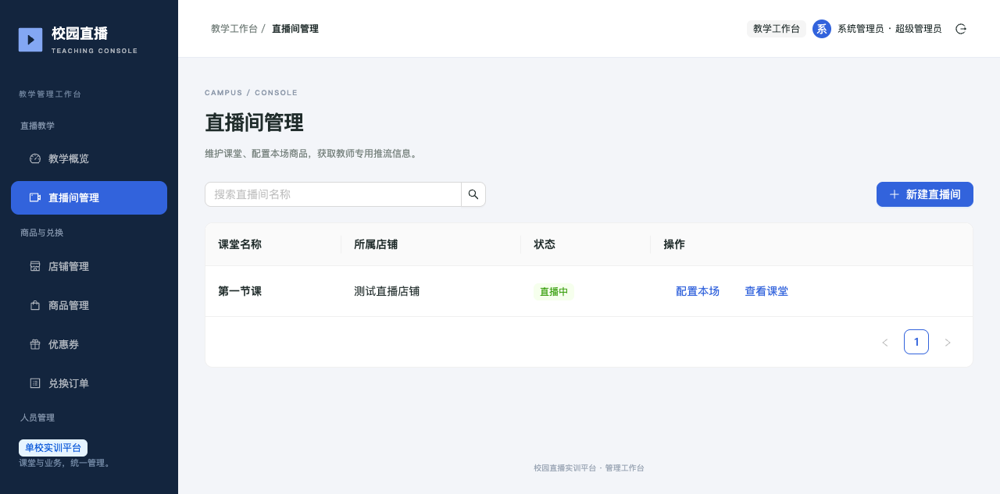

### 2.3 创建商品并绑定到本场

1. 进入「商品管理」→「新建商品」：选择店铺，填写商品名称、兑换所需积分和自提点，按需填写简介、上传图片（JPG / PNG / WebP，最大 3 MB）。
2. 保存后确认商品为上架状态。
3. 进入「直播间管理」→ 对应课堂的「配置本场」→「配置商品」：下拉选择**同店铺商品**，填写展示顺序（数字越小越靠前），点击「选好商品后点这里绑定到本场」。
4. 确认弹窗下方列表已出现商品，再点「完成」；重新打开本场配置可核对已绑定数量。

> **只在下拉框选中商品、然后直接点「完成」，不等于绑定成功**，必须先点绑定按钮。商品管理是资料库，绑定后员工才能在课堂小黄车里看到。

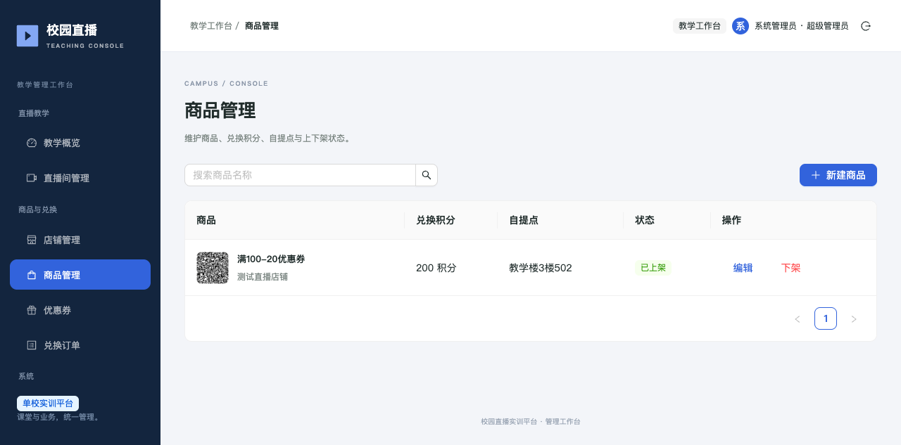

### 2.4 配置优惠券（可选）

优惠券有两个入口，数据同源：「优惠券」页统一管理各直播间的券；「配置本场」→「设置优惠券」查看本场券列表，需要时点「新建本场优惠券」。券属于指定直播间，创建后无需再"添加"到该课堂。

新建时填写名称、所属店铺、适用直播间、抵扣积分、到期日期。**规则**：每人每券限领一次、限用一次；只抵扣适用直播间的商品积分，抵扣不超过适用商品的小计；过期或被停用的券不可使用。

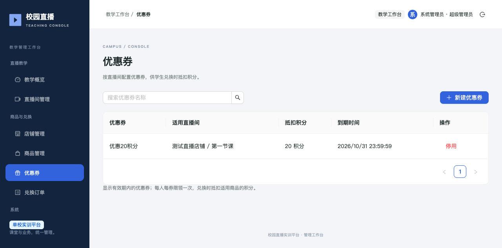

## 3. 管理员：OBS 安装、配置和开播

本节按界面名称逐项操作，不含 OBS 软件截图。不同系统或语言版本中，「直播」「推流」「串流」可能是相近功能的不同译名，以当前界面为准。

### 3.1 安装并获取本场推流信息

1. 从 OBS 官网 https://obsproject.com/ 下载安装包并安装。
2. 首次启动若出现「自动配置向导」（服务默认 Twitch），点击「取消」，使用下面的手动配置。
3. 在平台管理端进入「直播间管理」→「配置本场」→「获取 OBS 设置」。
4. 分别复制弹窗中的「OBS 服务器」和「OBS 串流密钥」。

**服务器格式示例**：

```text
rtmp://live.gaiademo.online:1935/live
```

**串流密钥格式示例（不是可用密钥）**：

```text
本场流名?token=系统生成的签名&expire=系统生成的时间戳
```

> 串流密钥必须完整复制，包括流名、`?token=` 和 `&expire=`。不要只复制 token，也不要把整条 RTMP 地址填进密钥框。有效期以平台弹窗显示为准；不要把密钥发给员工或放进公开文档。

### 3.2 设置推流服务器

OBS →「设置」→「直播/推流」：

| 字段 | 填写内容 |
| --- | --- |
| 服务 | 自定义 |
| 服务器 | 平台弹窗中的「OBS 服务器」 |
| 串流密钥/推流码 | 平台弹窗中的完整「OBS 串流密钥」 |

不需要连接 Twitch 账户，也不需要使用 Enhanced Broadcasting。

### 3.3 设置分辨率、帧率和编码

OBS →「设置」→「视频」：

| 配置项 | 建议起始值 |
| --- | --- |
| 基础（画布）分辨率 | 1920 × 1080，或保持显示器实际比例 |
| 输出（缩放）分辨率 | 1280 × 720 |
| FPS/帧率 | 25 或 30 |

OBS →「设置」→「输出」→ 输出模式切为「高级/高阶」→「直播」页签：

| 配置项 | 建议起始值 |
| --- | --- |
| 视频编码器 | **H.264**；有 Apple VideoToolBox / NVENC 等硬编可选，没有则 x264 |
| 速率控制 | CBR |
| 视频比特率 | 2000～2500 Kbps；人数增加时可降至 1200～1500 Kbps |
| 关键帧间隔 | 2 秒 |
| x264 预设 | veryfast（仅使用 x264 时） |
| 音频编码 / 码率 | AAC / 96 或 128 Kbps |

> 为方便手机观看，请使用 **H.264 + AAC**，不要选 AV1 或 HEVC/H.265。以上是起始配置，实际体验还受观众数量和网络影响。

### 3.4 添加画面和声音来源

1. OBS 主界面「来源」面板点「＋」。讲 PPT 或演示桌面：选择「显示器采集」「屏幕采集」或「macOS 屏幕采集」等对应来源，选择要共享的屏幕或窗口。
2. 需要出镜时再添加「视频采集设备」，选择摄像头，拖动缩放到画面角落。
3. macOS 首次采集若提示权限，到「系统设置 → 隐私与安全性」允许 OBS 录屏、麦克风、摄像头，按提示重新打开 OBS。
4. 在预览画面中右击来源 →「变换」→「适配屏幕」（如当前版本有此选项），避免只显示局部画面。
5. 对着麦克风说话，确认「混音器」对应音量条有波动且未静音。

> 直播前关闭私人聊天、通知和敏感窗口。不要把正在播放直播的网页也采集进去，以免无限套屏；员工端试听时戴耳机，避免回声。

### 3.5 开播与停播

**开播检查**：预览有画面 → 麦克风有波动 → 本场服务器/密钥已填好 → 点击「开始直播/开始推流」。

1. OBS 出现推流时长和输出码率后，返回平台查看课堂是否变为「直播中」（必要时刷新页面）。
2. 用另一浏览器或手机，以员工账号进入同一课堂，确认有画面、能听到声音。
3. 员工手机端首次起播可能需要等待缓冲；没有声音先点击播放器取消静音。
4. 下课后，在 OBS 点击「停止直播/停止推流」，课堂随后变为「已结束」。
5. 等待录制完成、上传后，在平台「查看回放」检查；长场次上传需要更久。

## 4. 管理员：账号、积分与订单交付

### 4.1 建号和密码重置

1. 进入「账号管理」→「新建账号」：填写登录账号，选择教师或学生角色；姓名可不填，不填时使用账号作为显示名。
2. 默认初始密码为 `123456`，可按学校要求修改；保存后单独通知本人账号、初始密码和正确入口。
3. 用户忘记密码：在其账号行点击「重置密码」；该用户需用新密码重新登录并再次改密。
4. 离校或不再使用的账号可「停用」，需要恢复时再「启用」。

> 账号和积分菜单依角色开放。若菜单存在但内容空白，或应有的菜单缺失，属于权限异常，请联系平台负责人核对，不要重复创建账号。

### 4.2 发放积分与核对流水

1. 进入「积分管理」，按姓名或账号找到人员，点击「调整积分」。
2. 选择增加、扣减或设置余额，输入积分数量和调整原因，提交后在确认弹窗中仔细核对，再确认执行。
3. 返回列表核对余额；点击「查看流水」可分页查看变动、原因、操作人和调整后余额。

> 「设置余额」是把余额改成指定数值，不是在现有余额上再增加；积分不能扣成负数。

### 4.3 交付完成后标记订单

进入「兑换订单」，按订单号、员工姓名、账号或商品搜索；展开订单核对商品数量、自提点或送货地点以及实扣积分；**实物已经交付后**，点击「标记完成」并确认。

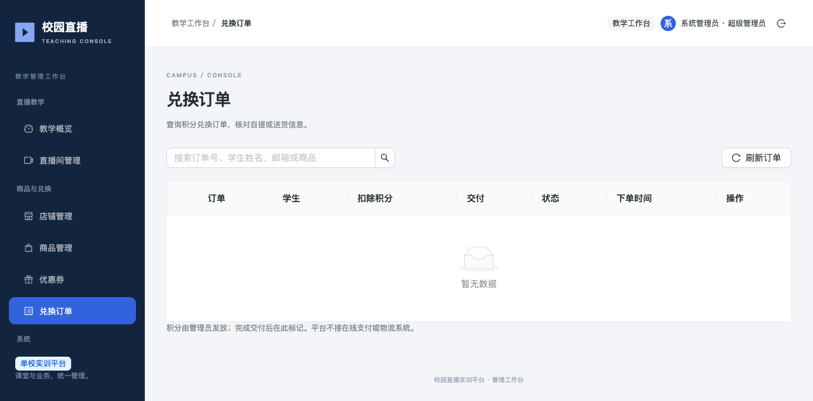

## 5. 员工：观看直播、聊天和领券

### 5.1 进入课堂

1. 打开学生端（员工入口），使用管理员分配的账号登录；首次使用先改密。
2. 在「直播课堂」中找到管理员通知的课堂，点击「进入课堂」；可按课堂名称或店铺搜索。
3. 管理员也可分享课堂链接，但链接不能代替登录权限。

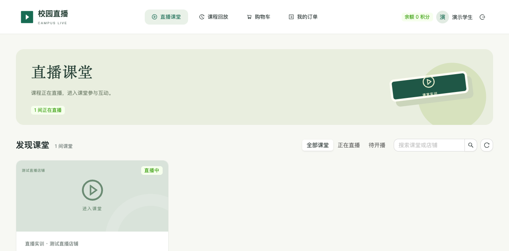

### 5.2 播放、声音与互动

- 等待播放器出现画面后点击播放；默认静音时，点击播放器音量按钮开启声音。
- 手机可用浏览器全屏或横屏观看；微信内无法正常播放时，尝试「在浏览器打开」。
- 在「课堂互动」输入文字后发送；不要频繁连续发送，不要发送密码、地址等私人信息。
- 手机观看与电脑画面可能有时间差，不代表直播出问题。

截图中的彩条是制作手册时的测试画面，正式课堂显示管理员通过 OBS 发送的内容。

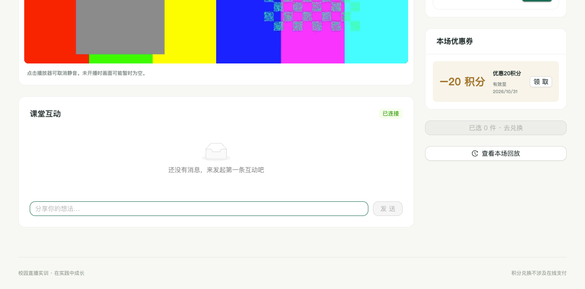

### 5.3 领取优惠券与选商品

1. 找到「本场优惠券」或点击「领券」，在需要的券旁点击「领取」。
2. 在「本场商品」中核对名称、积分价格，点击「加入」；手机端可点击「本场商品」「已选商品」或购物车入口展开小黄车。
3. 已领取不等于已使用，兑换时还需要在结算页选择该券。

## 6. 员工：积分兑换、提货与订单

1. 进入「购物车」或本场「已选商品」，确认商品和数量，移除不需要的商品。
2. 点击「去兑换」，核对积分余额、商品所需积分。
3. 在「使用已领取的优惠券」中选择适用券，核对优惠抵扣及实际扣除积分。
4. 选择交付方式：

| 交付方式 | 操作要求 |
| --- | --- |
| 自提（默认） | 查看各商品的自提点，按学校约定时间到现场领取 |
| 送货 | 填写准确送货地点（楼栋、房间或约定地点）；未填写不能提交 |

5. 核对无误后点「确认积分兑换」。余额不足时联系管理员充值，平台不涉及在线支付。
6. 成功后进入「我的订单」，核对订单编号、商品、扣除积分与交付方式。
7. 自提时向工作人员出示订单；送货的按学校约定方式等待线下交付，平台不提供快递轨迹。

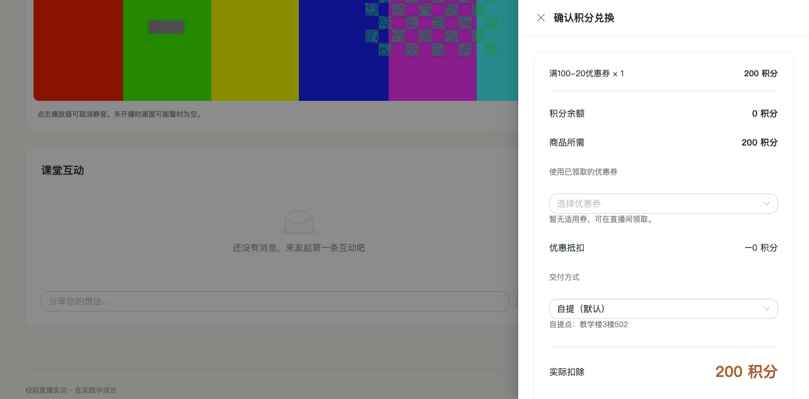

> 截图为结算演示：余额为 0，尚未成功兑换；正式操作请确保余额足够，并滚动到结算抽屉底部查看提交按钮。

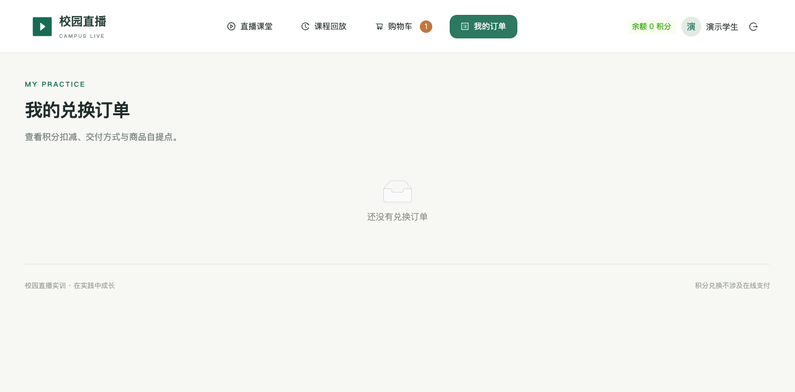

提交时遇到网络错误：先到「我的订单」确认是否已生成订单，避免反复提交。商品价格变化、下架、券过期等情况，请重新核对后再兑换。

## 7. 回放：员工与管理员

**员工**：打开「课程回放」→ 选择课堂 → 点击相应录制的「播放回放」。**管理员**：「直播间管理」→「配置本场」→「查看回放」。

- 一间课堂可能有多条回放（暂停/断开重推会形成新录制），按日期时间选择。
- 支持暂停、拖动和调节音量；手机端受浏览器策略影响时点击播放。
- 回放默认最多保留 180 天；磁盘紧张时可能从最旧的开始提前清理，但不会删除未满 90 天的回放。重要内容请提前与管理员约定留存。

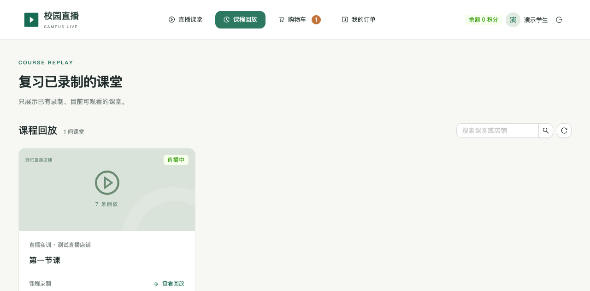

## 8. 常见问题速查

| 现象 | 先检查什么 | 下一步 |
| --- | --- | --- |
| 员工看不到课堂 | 是否还在「准备中」、是否登录学生端 | 管理员把课堂改为待开播，或直接正常推流 |
| OBS 推流失败 | 服务器和串流密钥是否填反、密钥是否完整或过期 | 获取本场新密钥保存后重试；仍失败联系管理员 |
| OBS 正常但网页无画面 | 是否同一课堂、是否刚开播、网页是否已过时 | 刷新后点重新连接，等待缓冲，用另一浏览器复核 |
| 网页提示已结束 | 管理员是否已停止/暂停推流 | 在 OBS 确认实际正在输出，不以网页按钮代替推流 |
| 手机没有声音 | 默认静音、手机系统音量 | 点击播放器取消静音；管理员检查混音器 |
| 画面黑屏 | 来源未添加或系统录屏权限未允许 | 在 OBS 本地预览确认画面后再推流 |
| 本场仍显示待配置 | 是否只选了商品、未点绑定按钮 | 点击绑定，核对列表出现商品后再完成 |
| 优惠券没有抵扣 | 是否领取、结算是否选择、是否适用/过期 | 按第 5、6 节核对；不是所有商品都适用 |
| 兑换按钮不可点 | 余额、商品状态、送货地点 | 充值积分、移除下架商品或补齐地点 |
| 停播后暂时没有回放 | 录制/上传仍在处理 | 稍后刷新回放；持续没有则联系管理员 |
| 两种身份互相顶替 | 同浏览器共用登录会话 | 换独立浏览器、无痕窗口或不同设备 |

报障时请提供：发生时间、使用入口、课堂名称、设备型号、浏览器名称、完整错误提示和截图。**不要提供账号密码或 OBS 串流密钥。**

## 9. 开课检查单

### 管理员（课前）

- [ ] 登录正确的管理端，核对本场课堂名称。
- [ ] 商品已上架并绑定，优惠券日期/适用课堂正确。
- [ ] OBS 来源有画面、麦克风有波动，H.264 + AAC。
- [ ] 获取本场有效密钥，保存到 OBS 后开始推流。
- [ ] 用员工账号实际确认画面、声音和商品入口。

### 员工（兑换前）

- [ ] 登录本人账号，进入管理员通知的课堂。
- [ ] 核对积分余额、商品、数量和优惠券。
- [ ] 确认自提点，或填准送货地点。
- [ ] 成功后核对「我的订单」，按学校约定领取商品。

### 管理员（下课）

- [ ] 在 OBS 停止推流，而不是只关闭平台网页。
- [ ] 核对课堂结束状态，稍后检查回放。
- [ ] 实物交付后再标记订单完成。
